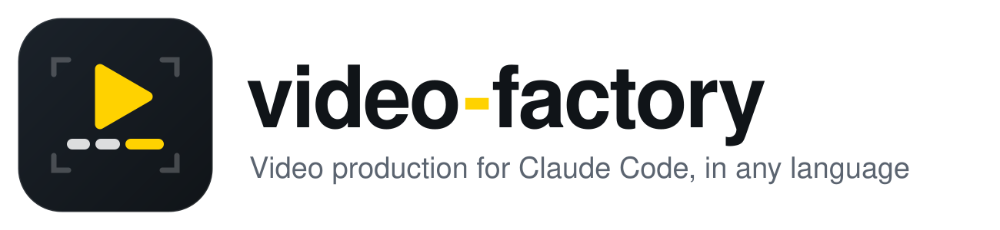
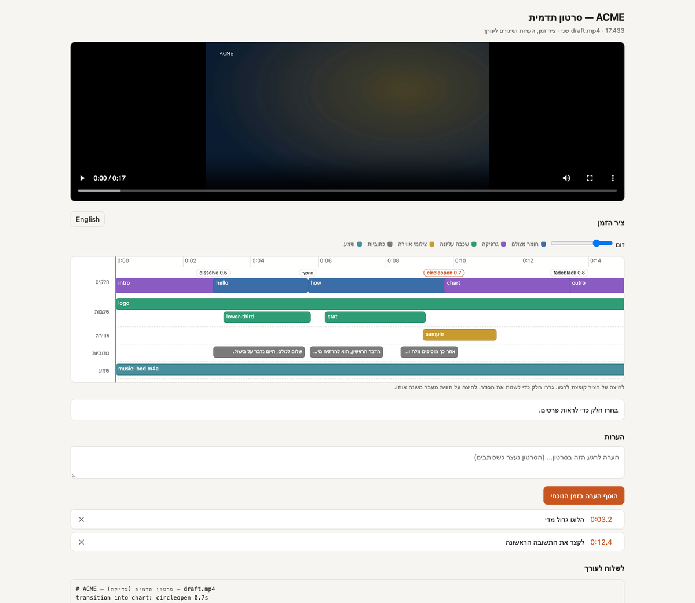

*[English](README.md) · עברית*

<p align="center">
  <picture>
    <source media="(prefers-color-scheme: dark)" srcset="docs/assets/wordmark-dark.svg">
    
  </picture>
</p>

<div dir="rtl">

# video-factory

הפקת סרטונים בשיחה עם Claude Code. שמים חומר גלם, או כותבים תסריט, ואומרים מה רוצים, למשל
*"תחתוך את הראיון לפי נושאים, תפתח בשקופית כותרת, כותרת תחתונה למנכ״ל, צילומי אווירה מהמפעל
כשהוא מדבר על המפעל, גרף של הצמיחה שלנו, מוזיקה, שקופית סיום, כתוביות בעברית וגרסה אנכית לרילס"*.
מקבלים קובץ `final.mp4` גמור.

**בכל שפה ש-Whisper מכיר** (אנגלית, ספרדית, צרפתית, גרמנית, ערבית ועוד כ-95), עם זמן לכל מילה,
כתוביות קריוקי וגרפיקה שפונה לכיוון הקריאה של השפה. **מימין לשמאל מובנה, ועברית מקבלת יחס מלא**:
מודל ivrit.ai לדיבור בעברית, הסרת הברות היסוס בעברית, וכתוביות וגרפיקה מימין לשמאל. העריכה רצה על
המחשב שלך, והחומר שלך לא יוצא ממנו.

**תיעוד מלא: [docs/](docs/README.he.md)**: התקנה, תהליך העבודה, כל הפקודות, מבנה story.json,
גרפיקה מונפשת, קריינות ומסירה.

## כל העריכה על ציר זמן, בדפדפן



לכל רינדור אפשר להוסיף **קובץ HTML אחד** שמציג את העריכה כמו שתוכנת עריכה מציגה אותה: הסרטון,
ומתחתיו ציר זמן של כל המסלולים (החלקים והמעבר בכל חיבור, גרפיקה, צילומי אווירה, כתוביות ומוזיקה),
עם סמן שזז יחד עם הניגון. **לא צריך שרת ולא צריך תוכנת עריכה**: פותחים בלחיצה כפולה, או שולחים
ללקוח יחד עם הסרטון.

על הציר אפשר לגרור חלק למקום אחר, ללחוץ על מעבר כדי להחליף אותו, ללחוץ על חלק כדי לראות מאיפה
הוא נחתך, ולעצור בכל רגע כדי להשאיר הערה. הכול חוזר כטקסט אחד ש-Claude מיישם בעריכה. בעברית
ובאנגלית, עם מתג.

</div>

```bash
python3 tools/vf.py review <name>     # renders/final_review.html, beside renders/final.mp4
```

<div dir="rtl">

עוד פרטים: [מסירה ← דף סקירה](docs/delivery.he.md#דף-סקירה-ציר-זמן-והערות-ללקוח).

## מה הוא עושה

הסקיל **video-orchestrator** מנצח על כל ההפקה, בשני מצבים: **מונחה חומר** (ראיונות, אירועים,
המלצות: מה שנאמר קובע את הסיפור) ו**מונחה תסריט** (סרטוני מוצר, הסברים: תסריט מוקרא קובע את הקצב).

**עריכה**
- **תמלול** עם זמן לכל מילה. **הסתכלות** על חומר בלי דיבור דרך גיליונות תמונות עם חותמות זמן,
  ו-Claude רושם מה רואים בכל צילום. אפשר גם לתת ל**מודל ראייה** שבוחרים (מקומי ב-LM Studio או
  ב-Ollama, או Gemini) לצפות: רשימת שוטים, ציון חזותי לקליפים קצרים, ובדיקת בעיות ברינדור.
- **חלוקה לפי משמעות**: חלקים של רעיון אחד או רגע אחד, וחיתוכים שזזים אל מחוץ למילים.
  אפשר גם לחתוך **בשניות מדויקות**.
- **בניית סיפור** עם נימוק לכל חלק, ו**המתנה לאישור שלך**.
- **ניקוי** הברות היסוס (אממ, אה) ושתיקות ארוכות. הכתוביות מתעדכנות לפי החיתוכים.
- **חיבור עם מעברים**: אם רוצים, מעבר שונה בכל חיבור, מתוך כ-60 סוגים (התמזגות, מעבר לשחור,
  ניגובים, החלקות, זום, עיגול, פיקסלים ועוד).

**שכבת התדמית**
- **ערכת מותג**: צבעים, לוגו ופונט שמוחלים על הכתוביות ועל כל הגרפיקה.
- **גרפיקה מונפשת ואינפוגרפיקה** ([HyperFrames](https://github.com/heygen-com/hyperframes)):
  שקופיות כותרת, כותרות תחתונות, מספרים שעולים, גרפי עמודות ושקופיות סיום, הכול מימין לשמאל.
  הגרפיקה מופיעה כשקופית על כל המסך או כשכבה שקופה מעל הווידאו, ואפשר לבנות אנימציות מיוחדות לפי בקשה.
- **צילומי אווירה מעל הדיבור**: Claude מתאים בין מה שנאמר לבין מה שצולם, ועובר לצילום המתאים.
- **מוזיקה** שיורדת מתחת לדיבור, ואם רוצים, חיתוך לפי הקצב. **מראה צבע** (LUT או תיקון).
- **קריינות מתסריט** דרך ספק הקראה (ElevenLabs, ‏Azure, ‏Google, ‏OpenAI, או הקול החינמי של macOS
  לתזמון). הוויזואליה מתוזמנת לכל מקטע, והכתוביות עוקבות אחרי הקריינות.

**מסירה**
- **כתוביות** שמתוזמנות מחדש לפי העריכה הסופית, מימין לשמאל, עם קריוקי לבחירה, ובנוסף
  **כתוביות בשפה נוספת** (שאפשר להפעיל ולכבות, או צרובות).
- **גרסאות** מאותו סיפור: אנכית לרילס, 30 שניות, 15 שניות.
- **סרטונים קצרים מסרטון ארוך**: רגעים מועמדים מהתמלול, Claude בוחר, וכל אחד מרונדר אנכי עם
  כתוביות מילה-אחר-מילה וכותרת וו.
- **דף סקירה עם ציר זמן ויזואלי**, בלי שרת ובלי תוכנת עריכה: כל המסלולים, גרירה לשינוי סדר, שינוי
  של כל מעבר והערות לפי זמן, בעברית או באנגלית. השינויים של הלקוח חוזרים כטקסט ש-Claude מיישם.
- **ייצוא ציר זמן** לעורך (Final Cut / ‏Resolve / ‏Premiere) ו**בדיקות פלטפורמה**.
- **לפני הצילום**: תדריך, רשימת צילומים ושאלות לראיון, ואחרי הצילום בדיקה שהכול צולם.

כל השאר (עוצמה, ניקוי שמע, שינויי מהירות, ייצוב, טשטוש, פרקים, ייצוא לפלטפורמות) מגיע
מהסקיל [ffmpeg-skill](https://github.com/kajisho5/ffmpeg-skill) שמצורף לפרויקט (42 כלים, MIT).

## למה video-factory

- **כל שפה, על המחשב שלכם, כולל מימין לשמאל.** תמלול ברמת מילה, קריוקי, הסרת הברות היסוס ("אממ",
  "um") עם תזמון מחדש של הכתוביות, וגרפיקה שפונה לכיוון הקריאה. לעברית יש מודל ייעודי (ivrit.ai),
  בזמן ש-Descript ו-OpusClip לא תומכים בה ו-Premiere ו-Resolve לא יודעים לתמלל אותה.
- **מחליט כמו עורך, ושואל לפני שהוא פועל.** חלקים לפי משמעות, סיפור עם נימוק לכל חלק, אישור שלכם לפני
  הרינדור, ובדיקת איכות אחריו.
- **ברמת תדמית, לא רק חיתוכים.** מיתוג, גרפיקה מונפשת ואינפוגרפיקה (מימין לשמאל כשהשפה כזאת), צילומי אווירה לפי מה
  שנאמר, מוזיקה מתחת לדיבור, קריינות מתסריט, גרסאות וסרטונים קצרים, הכול מעריכה אחת.
- **מסירה לשני הכיוונים.** דף סקירה שכל אחד יכול לפתוח, וציר זמן FCPXML / ‏EDL / ‏OTIO
  ל-Premiere, ‏Resolve או Final Cut. לאף כלי סוכן אחר שנסקר אין אף אחד מהשניים.
- **מראים, לא מתארים.** נותנים לו סרטון שאוהבים, והוא מודד את הקצב וקורא את המעברים.
- **פתוח ופרטי.** רישיון MIT, הכול מקומי (רק ההקראה, או מודל ראייה בענן, יוצאים מהמחשב, ורק אם
  בוחרים בהם), בלי חשבון.

איפה הוא חלש יותר (אין עורך גרפי, אין וידאו או אווטארים שנוצרים ב-AI, אין ספריית סטוק), ואיך הוא
עומד מול OpenMontage, ‏video-use, ‏Kinocut, ‏Descript, ‏OpusClip ואחרים:
[docs/comparison.he.md](docs/comparison.he.md).

## דרישות

- macOS או Linux, ‏Python 3.10 ומעלה
- **FFmpeg עם libass**: ב-macOS ‏`brew install ffmpeg-full`. הנוסחה הרגילה `ffmpeg` לא יודעת לצרוב כתוביות.
- **whisper.cpp** (מגיע עם ffmpeg-full) ומודל, שנמצא אוטומטית בתיקיית המטמון של Hugging Face:

</div>

```bash
pip install -U huggingface_hub
hf download ggerganov/whisper.cpp ggml-large-v3-turbo.bin         # 1.6 GB, every language
hf download ivrit-ai/whisper-large-v3-turbo-ggml ggml-model.bin   # 1.5 GB, Hebrew (only if you work in Hebrew)
```

<div dir="rtl">

  לעברית משמש מודל [ivrit.ai](https://huggingface.co/ivrit-ai), שטוב בהרבה בעברית אבל עונה בעברית
  על כל דיבור, ולכן כל שפה אחרת, וגם זיהוי שפה, צריכים את המודל הרב-לשוני.

- **Node.js 22 ומעלה** ו-Chrome, לגרפיקה המונפשת (HyperFrames רץ דרך `npx`)
- לבחירה: מפתח API של ספק קריינות, בקובץ `.env` (לא עולה ל-git)
- [Claude Code](https://claude.com/claude-code)

פרטים, משתני סביבה ופתרון תקלות: [docs/setup.he.md](docs/setup.he.md).

## התחלה מהירה

</div>

```bash
git clone <this repo> video-factory && cd video-factory
python3 tools/vf.py doctor
claude
```

<div dir="rtl">

ואז ב-Claude Code:

> תעשה פרויקט בשם *trip* מהתיקייה ‎~/Movies/trip, תחתוך לפי נושאים לסיפור של שתי דקות,
> תוריד את האממ ותוסיף כתוביות קריוקי בעברית.

> תעשה סרטון תדמית של 45 שניות ל-ACME מהתיקייה ‎~/Footage/acme: הראיון עם המנכ״ל, צילומי
> אווירה מהמפעל, הלוגו והצבעים שלנו, גרף של לקוחות לפי שנה, מוזיקה וגרסה לרילס.

> תכתוב תסריט של 30 שניות לאפליקציה שלנו, תקריא אותו עם Azure ותחתוך אליו את הקלטות המסך
> שבתיקייה ‎~/Desktop/app.

לא צריך להכין או להעתיק כלום. מספיק להצביע על תיקייה או על קבצים, והפרויקט מקשר אליהם.
הקבצים המקוריים לא משתנים לעולם. כדאי לבקש העתקה (`‎--copy`) כשהחומר נמצא בדיסק חיצוני או
בתיקיית ענן, או כשמתכננים להזיז את הקבצים המקוריים.

## מה אפשר לבקש

מבקשים במילים שלכם, בכל שפה. אלה דוגמאות ולא פקודות קבועות. Claude שואל רק
כשהתשובה משנה את התוצאה. אחרת הוא בוחר ברירת מחדל סבירה ואומר לכם מה בחר.

### פתיחת פרויקט

| בקשה | מה קורה |
|---|---|
| "תפתח פרויקט בשם trip מהתיקייה ‎~/Movies/trip" | כל הסרטונים בתיקייה מקושרים ל-`projects/trip/` |
| "…משני הקבצים a.mov ו-b.mp4" | רק הקבצים האלה מקושרים |
| "תעתיק אותם, הם בדיסק חיצוני" | העתקה במקום קישור (גם לחומר ב-iCloud או ב-Google Drive, או לקבצים שתזיזו) |
| "תוסיף את clip3.mp4 לפרויקט trip" | מוסיף קובץ מקור לפרויקט קיים |
| "…זה בעברית" | ‏`--language he`: נשמר ב-`project.json`, וכל שלב הולך לפיו |

### תמלול והבנה

| בקשה | מה קורה |
|---|---|
| "תתמלל" | תמלול עם זמן לכל מילה; השפה מזוהה ונשמרת |
| "תתמלל, הדוברים הם הרב כהן ודנה, הנושא הדלקת נרות שבת" | שמות ומונחים עוברים כהנחיה ונכתבים נכון |
| "זה בספרדית" / "הפרויקט בעברית" | קובע את שפת הפרויקט; תמלול, ניקוי, כתוביות, גרפיקה וקריינות הולכים לפיה |
| "תתמלל מחדש" | תמלול חוזר (אחרי החלפת מודל או הנחיה) |
| "תראה לי את התמלול" / "…עם זמני המילים" | התמלול לפי קטע וזמן, הברות היסוס מסומנות |
| "מה רואים בסרטון?" / "אין בו דיבור, זה צילומי טיול" | גיליונות תמונות וחילופי סצנה, ו-Claude מתאר כל צילום |
| "איפה הוא מדבר על X?" | מאתר את הרגע בתמלול |
| "תן למודל הראייה לעבור על צילומי האווירה" | ‏`vf.py watch`: שוטים, איכות, אנרגיה והצעות לצילומי אווירה, מהמודל שהגדרת |

### חיתוך

| בקשה | מה קורה |
|---|---|
| "תחתוך לפי נושאים" | חלקים לפי משמעות, רעיון אחד בכל חלק, עם טבלת חלקים |
| "תחתוך מ-1:20 עד 1:45" / "משנייה 12 עד 30" | חותך בדיוק שם, ומזהיר אם החיתוך נופל באמצע מילה |
| "תשאיר רק את החלק על הפסטה" | חלק אחד, עם קצוות בשקט שמסביבו |
| "תוריד את הקטע מ-2:10 עד 2:40" | מסיר את הטווח |
| "תוריד את החזרות" | משאיר את הצילום הנקי האחרון של משפט שחוזר על עצמו |
| "תעשה מזה שתי דקות" / "60 השניות הכי טובות" | בוחר חלקים לפי האורך המבוקש |
| "רק הצילומים של הים" | חלקים לפי מה שרואים (אחרי "מה רואים בסרטון") |

### בניית הסיפור

| בקשה | מה קורה |
|---|---|
| "תעשה מזה סיפור" | מציע סדר עם נימוק לכל חלק ומחכה לאישור |
| "תפתח בטיפ על שינה" / "תסיים בתודה" | מזיז חלק |
| "תחליף בין 2 ל-3" / "תוריד את חלק 4" / "תכניס את צילום הנמל אחרי חלק 1" | עריכת הסדר |
| "תשים צילומי אווירה על ההסבר הארוך" | צילומי אווירה בין חלקי הדיבור |
| "מאושר" / "סע" | ממשיך ליצירת הסרטון |

### ניקוי הדיבור

| בקשה | מה קורה |
|---|---|
| "תוריד את האממ" / "תוריד את הגמגומים" | מסיר אממ, אה וכדומה (לא מילים אמיתיות כמו "כאילו") |
| "תקצר את השתיקות" / "בלי שתיקה ארוכה מחצי שנייה" | מקצר את השקט בין המילים |
| "אל תנקה את הסוף, השתיקה שם מכוונת" | שליטה ברמת החלק |

### מעברים

| בקשה | מה קורה |
|---|---|
| "דהייה בין החלקים" / "מעבר לשחור" / "התמזגות" | קובע את סוג המעבר |
| "מעבר ארוך יותר, שנייה" | קובע את משך המעבר |
| "ניגוב" / "החלקה" / "עיגול" | ‏`wipeleft`, ‏`slideleft`, ‏`circleopen` ושאר הסוגים |
| "חיתוכים ישרים, בלי מעברים" | `none` |
| "התמזגות לראיון, זום לגרף, מעבר לשחור לפני הסוף" | מעבר שונה בכל חיבור |
| "תשתמש במעברים כמו בקטע הזה" (קובץ) | קורא אותם מהקטע וקובע כל חיבור |

### כתוביות

| בקשה | מה קורה |
|---|---|
| "תוסיף כתוביות" | צרובות, עד שתי שורות, מימין לשמאל בעברית או בערבית |
| "קריוקי" / "תדגיש כל מילה כשהיא נאמרת" | הדגשה מילה אחרי מילה לפי הזמנים האמיתיים |
| "מילה אחת מודגשת בכל פעם, כמו בטיקטוק" | קריוקי בסגנון `word` |
| "יותר גדול" / "למעלה" / "פונט Heebo" | גודל, מיקום, פונט |
| "שיקפצו פנימה" / "שיופיעו בדהייה" | אנימציה לכתוביות |
| "כתוב 'בהריים', צריך להיות 'בהרים'" | מתקן את הכתיב, אף פעם לא את התוכן |
| "בלי כתוביות על צילומי האווירה" | שליטה ברמת החלק |
| "בלי כתוביות בכלל" | מכבה אותן |

### פורמט ותוצאה

| בקשה | מה קורה |
|---|---|
| "אנכי, לרילס" / "ריבועי" | ‏9:16 או 1:1 עם שוליים, או "תחתוך" במקום שוליים |
| "4K" / "720p" / "25 פריימים" | גודל וקצב פריימים |
| "תראה לי טיוטה" | יצירה מהירה וגיליון תמונות ש-Claude בודק |
| "גרסה סופית" | יצירה באיכות מלאה |
| "זה בסדר להעלות ליוטיוב / לרילס / לטיקטוק?" | בדיקות פלטפורמה: גודל, אורך, עוצמה, קידוד |
| "תייצא ליוטיוב" / "מתחת ל-25MB" / "תצוגה מקדימה כ-GIF" | ייצוא לפלטפורמה |

### תכנון (לפני הצילום)

| בקשה | מה קורה |
|---|---|
| "תעזור לי לתכנן סרטון תדמית ל-X" | תדריך: מטרה, קהל, מסר אחד, קריאה לפעולה, אורך |
| "מה לצלם?" / "שאלות לראיון עם המנכ״ל" | רשימת צילומים ושאלות שמפיקות ציטוטים טובים |
| "צילמתי הכול?" | משווה את החומר והתמלול לרשימת הצילומים |
| "שיהיה כמו הפרסומת הזו" (קובץ) / "אני אוהב את המעברים האלה" (קטע) | לומד את הקצב, המעברים, הכתוביות והגרפיקה שלו, ומחיל אותם על העריכה שלכם |
| "איפה אנחנו?" / "מה הלאה?" | `status`: מה נעשה בכל פרויקט ומה הצעד הבא |

### מיתוג וגרפיקה מונפשת

| בקשה | מה קורה |
|---|---|
| "הצבעים שלנו ‎#FFB000 וכחול כהה, הנה הלוגו" | `brand.json`, והכתוביות וכל הגרפיקה משתמשות בו |
| "תפתח בשקופית כותרת: 'מבשלים חכם'" | שקופית כותרת על כל המסך, בצבעי המותג |
| "כותרת תחתונה למנכ״ל: ישראל ישראלי, מנכ״ל" | שם ותפקיד מעל הווידאו, מעל הכתוביות |
| "תראה 98% שביעות רצון כשהוא אומר את זה" | מספר שעולה, מעל הווידאו או כשקופית |
| "גרף של לקוחות לפי שנה: 12, 19, 31" | גרף עמודות מונפש, מימין לשמאל |
| "תסיים עם האתר והטלפון שלנו" | שקופית סיום עם לוגו וקריאה לפעולה |
| "הלוגו שלנו בפינה כל הזמן" | שכבת לוגו |
| "אנימציה שמראה את 3 שלבי התהליך" | גרפיקה מיוחדת שנבנית ב-HyperFrames |

### צילומי אווירה, מוזיקה ומראה

| בקשה | מה קורה |
|---|---|
| "תכסה אותו בצילומי המפעל כשהוא מדבר על המפעל" | צילומי אווירה לפי מה שנאמר, והקול ממשיך |
| "מוזיקה מתחת" / "יותר חלש" / "חיתוכים לפי הקצב" | פס מוזיקה שיורד מתחת לדיבור, ורשת פעמות לתזמון |
| "שתי המצלמות שיתאימו" / "יותר חם" / "תחיל את ה-LUT הזה" | מעבר צבע אחד על כל העריכה |

### קריינות וסרטוני מוצר

| בקשה | מה קורה |
|---|---|
| "תכתוב תסריט של 30 שניות לאפליקציה" | `script.md`, מקטע בכל פסקה, עם הערות ויזואליות |
| "תקריא" (קול טיוטה חינמי) / "…עם Azure, קול גברי" / "…עם הקול X ב-ElevenLabs" | קריינות לכל מקטע, מתוזמנת ומתומללת |
| "תקליט מחדש את מקטע 2, לאט יותר" | מקליט מחדש מקטע אחד |
| "תחתוך את הקלטות המסך לפי הקריינות" | הוויזואליה מותאמת מקטע אחרי מקטע, והכתוביות עוקבות אחרי הקריינות |
| "תשאיר את קול החדר מתחת לקריינות" | הקריינות מעורבבת מעל הקול של החומר |

### גרסאות, תרגום והערות

| בקשה | מה קורה |
|---|---|
| "גרסה אנכית לרילס" / "גרסה של 15 שניות" | `versions` בסיפור, מאותה עריכה |
| "גם כתוביות באנגלית" / "צרובות" | ערוץ כתוביות מתורגם (שאפשר להפעיל ולכבות), או צריבה בראש המסך |
| "תכין דף הערות ללקוח" / "…באנגלית" | דף עם ציר זמן והערות; הלקוח יכול גם לשנות סדר חלקים ומעברים |
| "הנה ההערות של הלקוח: …" | כל הערה ממופה לחלק ומיושמת |
| "תעביר לעורך שלי ב-Premiere / ‏Resolve" | ציר זמן FCPXML / ‏EDL של העריכה |

### סרטונים קצרים מסרטון ארוך

| בקשה | מה קורה |
|---|---|
| "תמצא את הרגעים הכי טובים לרילס בראיון הזה" | מועמדים מדורגים מהתמלול; Claude בוחר ומסביר |
| "תעשה 5 קליפים של 30–45 שניות" | `clips.json`, לכל אחד כותרת וו |
| "תרנדר אותם, עם הלוגו שלנו ושקופית סיום" | קליפים אנכיים עם כתוביות מילה-אחר-מילה, מנוקים, עם בדיקת איכות |
| "הוו של קליפ 3 חלש, תחליף" | עורך את הקליפ הזה ומרנדר רק אותו |
| "תדרג אותם גם לפי התמונה" | מודל הראייה נותן ציון לתגובות ולתנועה בכל מועמד, והדירוג משלב מילים ותמונה |
| "תצפה בסרטון הסופי ותבדוק אם יש בעיות" | מודל הראייה מחפש טקסט על פנים, ראשים חתוכים, פריימים שחורים ולוגו שלא רואים |

### ליטוש התוצאה (כלי ffmpeg-skill)

| בקשה | מה קורה |
|---|---|
| "תנרמל את העוצמה" | ‏‎-14 LUFS (או רמות שידור) |
| "תנקה את השמע" / "תוריד את הרחש" | ניקוי קול והפחתת רעש |
| "מוזיקה מתחת לדיבור, שתרד כשמדברים" | פס מוזיקה שיורד מתחת לדיבור, עם דהייה בסוף |
| "הלוגו שלנו למעלה מימין" / "סימן מים" | שכבת תמונה |
| "כותרת ל-4 השניות הראשונות" / "כותרת תחתונה עם השם שלי" | תבניות טקסט וגרפיקה |
| "שקופית פתיחה" / "אפקט קן ברנס על התמונה הזו" | הכנסת תמונה עם תנועה |
| "תאיץ את הקטע הזה" / "הילוך איטי כאן" / "תקפיא את הפריים האחרון" | שינויי מהירות והקפאה |
| "תבהיר" / "תתקן את איזון הלבן" / "תחיל את ה-LUT הזה" | תיקון צבע |
| "תייצב" / "תיישר את האופק" | תיקון רעידות והטיה |
| "תטשטש את הפנים / את לוחית הרישוי" | טשטוש באזור שתסמנו |
| "תוסיף פרקים" | פרקים ליוטיוב במטא-דאטה של הקובץ |
| "תסנכרן את המיקרופון החיצוני" | מיישר הקלטת שמע נפרדת |

## מבנה

</div>

```
.claude/skills/video-orchestrator/   הסקיל המתזמר: מצבים, שלבים, כללים
.claude/skills/ffmpeg-skill/         הסקיל המבצע (MIT, kajisho5): 42 כלי ffmpeg (תיקון מקומי: VENDORED.md)
.agents/skills/                      הסקילים של HyperFrames (Apache-2.0), מקושרים ל-.claude/skills/
templates/motion/                    תבניות גרפיקה: lower-third, title, end-card, stat, bar-chart
tools/vf.py                          כלי שורת הפקודה שהסקיל מפעיל (+ vf_motion.py, vf_voice.py, vf_review.py, vf_vision.py)
tools/fillers.<lang>.txt             הברות ההיסוס שהניקוי מסיר, לכל שפה (en, he, es, fr, de)
docs/                                תיעוד מלא, באנגלית ובעברית
projects/<name>/                     הפרויקטים שלך: לא עולים ל-git
```

<div dir="rtl">

אפשר להשתמש ב-`tools/vf.py` גם לבד (כל הפקודות: [docs/cli.he.md](docs/cli.he.md)):

</div>

```bash
python3 tools/vf.py new demo ~/Movies/trip       # a folder or files; --copy to copy; --language en|he|…
python3 tools/vf.py transcribe demo              # word timings
python3 tools/vf.py frames demo                  # contact sheets + scenes, for footage without speech
python3 tools/vf.py watch demo                   # optional: a vision model's shot log (docs/vision.md)
python3 tools/vf.py transcript demo --words      # read it, then write projects/demo/story.json
python3 tools/vf.py voice demo --provider say    # narration from script.md
python3 tools/vf.py render demo --draft
python3 tools/vf.py render demo --version reels
python3 tools/vf.py review demo                  # client notes page
python3 tools/vf.py export demo --format fcpxml  # editor timeline
python3 tools/vf.py reference demo ~/ad.mp4      # study a video to imitate
python3 tools/vf.py status                       # every project and its next step
python3 tools/vf.py ff <tool> --help             # any ffmpeg-skill tool, with the right ffmpeg
```

<div dir="rtl">

## מודל ראייה (אופציונלי): איפה יושב ה-API

‏`vf.py watch` מעביר את החומר למודל ראייה שאתם בוחרים, והוא מציע: רשימת שוטים, ציון חזותי לקליפים
ובדיקת הסרטון הסופי. אפשר להגדיר פעם אחת בקובץ `.env` (העתיקו את `.env.example`, שמפרט את כל
המשתנים), או בכל פקודה עם הדגלים `--base-url` ו-`--model`.

- **סוג `openai`:** מתאים לכל שרת שתואם ל-OpenAI, כמו LM Studio, ‏Ollama, מחשב עם GPU ברשת
  הביתית, OpenAI או OpenRouter. משנים רק את הכתובת.
- **סוג `gemini`:** היחיד שצופה בווידאו עם הסאונד, כך שהוא קולט צחוק, תגובות ומוזיקה. השאר רואים
  רק תמונות סטילס.
- **פרטיות:** כל כתובת מחוץ למחשב או לרשת שלכם נחסמת, אלא אם מוסיפים `--allow-cloud`. ל-Gemini עולה
  עותק קטן ב-480p, שנמחק אחרי התשובה.
- **בדיקה:** ‏`vf.py doctor` מראה איזה מודל ראייה מוגדר והאם הוא עונה.

</div>

```bash
# .env
VF_VISION_PROVIDER=openai
VF_VISION_BASE_URL=http://localhost:1234/v1     # LM Studio; Ollama: http://localhost:11434/v1
VF_VISION_MODEL=google/gemma-4-e4b
```

<div dir="rtl">

הפירוט המלא: [docs/vision.he.md](docs/vision.he.md).

## כלי משלים מומלץ: ‏`/watch`

[claude-video](https://github.com/bradautomates/claude-video) (MIT) מאפשר ל-Claude **לצפות**
בסרטון מקישור או מקובץ: פריימים ותמלול. הוא לא עורך. הוא שימושי לסרטוני **השראה**, למשל "שהתדמית
שלנו תרגיש כמו הפרסומת הזו": Claude צופה בפרסומת ומפרק את הקצב, המעברים והגרפיקה שלה לפני
שהוא מתכנן את שלכם. זה תוסף נפרד ולא חלק מהפרויקט:

</div>

```
/plugin marketplace add bradautomates/claude-video
/plugin install watch@claude-video
```

<div dir="rtl">

מנוע Gemini שלו (לבחירה) מעלה את הסרטון לגוגל, ולכן חומר של לקוחות כדאי להשאיר בכלים המקומיים
של video-factory.

## השוואה לכלים אחרים

מול כלי הסוכנים (‏OpenMontage, ‏video-use, ‏Kinocut ועוד) ומול עורכים מסחריים (‏Descript, ‏CapCut, ‏OpusClip, ‏Premiere, ‏Resolve): מה הפרויקט עושה שהם לא, ואיפה הוא חלש. ראו [docs/comparison.he.md](docs/comparison.he.md).

## מגבלות כרגע

- בקריוקי, מילה מודגשת מסוף המילה הקודמת ועד סוף המילה שלה, ולכן ההדגשה מקדימה מעט את הקול.
- ספקי הקריינות בתשלום בנויים לפי ה-API המתועד של כל ספק, אבל עוד לא הורצו כאן עם מפתח אמיתי.
  הקול החינמי של macOS נבדק.
- ‏`vf.py watch` נבדק עם מודל מקומי (Gemma 4 ב-LM Studio). המסלול של Gemini בנוי לפי ה-API המתועד
  שלו, אבל עוד לא הורץ כאן עם מפתח אמיתי.
- תבניות הגרפיקה עוצבו ל-16:9. בגרסאות אנכיות הן מסתדרות מחדש, אז כדאי לבדוק את הטיוטה.

## רישיון

MIT, ראו [LICENSE](LICENSE). רכיבי צד שלישי (ffmpeg-skill ברישיון MIT, הסקילים של HyperFrames
ברישיון Apache-2.0 ועוד): [THIRD_PARTY.md](THIRD_PARTY.md).

</div>
