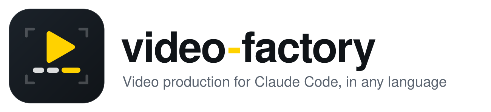

*English · [עברית](README.he.md)*

<p align="center">
  <picture>
    <source media="(prefers-color-scheme: dark)" srcset="docs/assets/wordmark-dark.svg">
    
  </picture>
</p>

# video-factory

Make videos by talking to Claude Code. Drop in raw footage, or write a script, and say what
you want: *"cut the interview by topic, open with a title card, a lower third for the CEO, cover
the factory talk with b-roll, a chart of our growth, music, end card, captions, and a
vertical version for Reels"*. You get back a finished `final.mp4`.

**Any language Whisper speaks** (English, Spanish, French, German, Arabic and about 95 more), with a
time for every word, karaoke captions and graphics that follow the language's reading direction.
**Right-to-left is built in, and Hebrew is first-class**: the ivrit.ai model for Hebrew speech,
Hebrew hesitation sounds removed, and captions and graphics laid out right to left. Editing runs
locally, and your footage never leaves your machine.

**Full documentation: [docs/](docs/README.md)**: setup, workflow, every command, the
story.json reference, motion graphics, voice-over, delivery.

## What it does

The **video-orchestrator** skill conducts the whole production, in two modes:
**footage-led** (interviews, events, testimonials: what is said sets the story) and
**script-led** (product promos, explainers: a narrated script sets the timing).

**Editing**
- **Transcribe** with a time for every word. **Look** at footage without speech through
  timecoded contact sheets, and Claude writes down what each shot shows. Optionally a **vision model**
  you choose (local in LM Studio or Ollama, or Gemini) watches too: shot log, visual scores for
  shorts, and a look for problems in the render.
- **Segment by meaning**: parts of one idea or one moment each, with cuts moved out of words.
  Or cut at **exact seconds**.
- **Build a story** with a reason for each part, and **wait for your approval**.
- **Clean** hesitation sounds (אממ, אה) and long pauses; captions follow the cuts.
- **Join with transitions**: a different one at each junction if you like, from about 60 types
  (dissolve, fade-to-black, wipes, slides, zoom, circle, pixelize…).

**Promo layer**
- **Brand kit**: colours, logo and font applied to captions and every graphic.
- **Motion graphics and infographics** ([HyperFrames](https://github.com/heygen-com/hyperframes)):
  title cards, lower thirds, counting numbers, bar charts and end cards, all right-to-left, as
  full-screen cards or transparent overlays, plus custom animations built on demand.
- **B-roll over speech**: Claude matches what is said to what was filmed and cuts away.
- **Music** that ducks under speech, cut on the beat if you want. **Colour look** (LUT or correction).
- **Voice-over from a script** through a TTS provider (ElevenLabs, Azure, Google, OpenAI, or the
  free macOS voice for timing). Visuals are timed to each beat and captions follow the narration.

**Delivery**
- **Captions** re-timed onto the final edit, right-to-left, optional karaoke, plus
  **second-language subtitles** (toggleable or burned).
- **Versions** from one story: vertical for Reels, 30 s, 15 s.
- **Shorts from a long video**: candidate moments from the transcript, Claude picks, and each
  renders vertical with word-by-word captions and a hook title.
- **Review page with a visual timeline**, with no server and no editing app: every track, drag to
  reorder, change any transition, timecoded notes, in English or Hebrew. The client's changes come
  back as text that Claude applies.
- **Editor timeline** export (Final Cut / Resolve / Premiere) and **platform checks**.
- **Pre-production**: brief, shot list and interview questions before filming, and a coverage
  check after.

Everything else (loudness, audio clean-up, speed ramps, stabilisation, redaction, chapters,
platform exports) comes from the vendored [ffmpeg-skill](https://github.com/kajisho5/ffmpeg-skill)
(42 tools, MIT).

## Why video-factory

- **Any language, on your machine, right-to-left included.** Word-level transcription, karaoke,
  fillers ("um", "uh", "אממ") removed with captions re-timed, and graphics that follow the reading
  direction. Hebrew gets a dedicated model (ivrit.ai), where Descript and OpusClip don't support it
  and Premiere and Resolve can't transcribe it.
- **It decides like an editor, and asks before acting.** Parts by meaning, a story with a reason for
  every part, your approval before rendering, and a QA check after.
- **Promo-grade, not just cuts.** Brand, motion graphics and infographics (right-to-left when the language is), b-roll matched to the
  words, music under speech, narration from a script, versions and shorts, all from one edit.
- **Hand-off both ways.** A review page anyone can open, and an FCPXML / EDL / OTIO timeline for
  Premiere, Resolve or Final Cut. No other agent tool surveyed has either.
- **Show, don't describe.** Give it a video you like, and it measures the pace and reads the transitions.
- **Open and private.** MIT, local (only TTS, or a cloud vision model, leaves the machine, and only if
  you choose it), no account.

Where it is weaker (no GUI editor, no AI-generated footage or avatars, no stock library) and how it
compares with OpenMontage, video-use, Kinocut, Descript, OpusClip and others:
[docs/comparison.md](docs/comparison.md).

## Requirements

- macOS or Linux, Python 3.10+
- **FFmpeg with libass**: `brew install ffmpeg-full` on macOS. The plain `ffmpeg` formula
  cannot burn captions.
- **whisper.cpp** (comes with ffmpeg-full) and a model, found automatically in the Hugging Face cache:
  ```bash
  pip install -U huggingface_hub
  hf download ggerganov/whisper.cpp ggml-large-v3-turbo.bin         # 1.6 GB, every language
  hf download ivrit-ai/whisper-large-v3-turbo-ggml ggml-model.bin   # 1.5 GB, Hebrew (only if you work in Hebrew)
  ```
  Hebrew uses the ivrit.ai model, which is far better at Hebrew but answers in Hebrew whatever is
  spoken, so every other language, and language detection, needs the multilingual one.
- **Node.js 22+** and Chrome, for motion graphics (HyperFrames runs through `npx`)
- Optional: an API key for a voice-over provider, in `.env` (gitignored)
- [Claude Code](https://claude.com/claude-code)

Details, environment variables and troubleshooting: [docs/setup.md](docs/setup.md).

## Quick start

```bash
git clone <this repo> video-factory && cd video-factory
python3 tools/vf.py doctor
claude
```

Then, in Claude Code:

> Make a project called *trip* from ~/Movies/trip, cut it by topic into a 2-minute story,
> take out the ums, and add karaoke captions.

> הכן פרויקט בשם *טיול* מ-~/Movies/trip, בעברית, עם כתוביות קריוקי מימין לשמאל.

> Make a 45-second promo for ACME from ~/Footage/acme: the CEO interview, b-roll of the factory,
> our logo and colours, a chart of customers by year, music, and a Reels version.

> Write a 30-second script for our app, narrate it with Azure, and cut the screen recordings
> in ~/Desktop/app to it.

You don't need to prepare or copy anything. Point at a folder or at files, and the project
links to them; your originals are never modified. Ask for a copy (`--copy`) when the footage
is on an external drive or in a cloud folder, or when you plan to move the originals.

## What you can ask

Say it in your own words, in any language. These are examples, not fixed commands.
Claude asks only when the answer changes the result, and otherwise picks a sensible default
and tells you which.

### Starting a project

| Ask | What happens |
|---|---|
| "Start a project called *trip* from ~/Movies/trip" | links every video in the folder into `projects/trip/` |
| "…it's in Hebrew" | `--language he`: stored in `project.json`, so every step follows it |
| "…from these two files: a.mov, b.mp4" | links just those files |
| "Copy them in, they're on an external drive" | copies instead of linking (also for iCloud / Google Drive, or originals you will move) |
| "Add clip3.mp4 to the trip project" | adds a source to an existing project |

### Transcribing and understanding

| Ask | What happens |
|---|---|
| "Transcribe it" | a transcript with a time for every word; the language is detected and remembered |
| "Transcribe it — the speakers are Rabbi Cohen and Dana, it's about Shabbat candles" | names and terms go in as a prompt, so they are spelled right |
| "It's in Spanish" / "the project is in Hebrew" | sets the project's language; transcription, cleaning, captions, graphics and voice follow it |
| "Transcribe again" | redoes it (after changing the model or the prompt) |
| "Show me the transcript" / "…with word times" | prints it by clip and time; fillers are marked |
| "What's in the footage?" / "There's no talking, it's travel footage" | contact sheets and scene changes; Claude describes each shot |
| "Where does he talk about X?" | finds the moment in the transcript |
| "Have the vision model go over the b-roll" | `vf.py watch`: shots, quality, energy, b-roll suggestions, from the model you set |

### Cutting

| Ask | What happens |
|---|---|
| "Cut it by topic" | parts by meaning, one idea each, with a table of parts |
| "Cut from 1:20 to 1:45" / "seconds 12 to 30" | cuts exactly there; warns if it lands mid-word |
| "Keep only the part about pasta" | one part, edges in the silence around it |
| "Take out the bit from 2:10 to 2:40" | removes that range |
| "Drop the retakes" | keeps the last clean take of a repeated sentence |
| "Make it 2 minutes" / "the best 60 seconds" | chooses parts to fit the length |
| "Only the shots of the sea" | parts chosen by what is seen (after "what's in the footage") |

### Building the story

| Ask | What happens |
|---|---|
| "Make a story out of it" | proposes an order with a reason for each part, then waits for you |
| "Open with the sleep tip" / "end with the thank-you" | moves a part |
| "Swap 2 and 3" / "drop part 4" / "add the harbour shot after part 1" | edits the order |
| "Put b-roll over the long explanation" | b-roll between talking parts |
| "Approved" / "go" | goes on to render |

### Cleaning speech

| Ask | What happens |
|---|---|
| "Take out the ums" / "remove the hesitations" | removes אממ, אה and the like (not real words like "כאילו") |
| "Tighten the pauses" / "no pause longer than half a second" | shortens silences between words |
| "Don't clean the ending, the pause there is on purpose" | per-part control |

### Transitions

| Ask | What happens |
|---|---|
| "Fade between parts" / "fade to black" / "dissolve" | sets the transition |
| "Longer transition, one second" | sets its duration |
| "Wipe" / "slide" / "circle" | `wipeleft`, `slideleft`, `circleopen` and the rest |
| "Straight cuts, no transitions" | `none` |
| "Dissolve into the interview, zoom into the chart, fade to black before the end" | a different transition at each junction |
| "Use transitions like in this clip" (a file) | reads them from the clip and sets each junction |

### Captions

| Ask | What happens |
|---|---|
| "Add captions" | burned in, two lines at most, right-to-left for Hebrew or Arabic |
| "Karaoke" / "highlight each word as it's spoken" | word-by-word highlight from real timings |
| "One bold word at a time, like TikTok" | karaoke `word` style |
| "Bigger" / "at the top" / "font Heebo" | size, position, font |
| "Make them pop in" / "fade in" | caption animation |
| "It says 'בהריים', it should be 'בהרים'" | fixes the wording, never the content |
| "No captions on the b-roll" | per-part control |
| "No captions at all" | turns them off |

### Format and output

| Ask | What happens |
|---|---|
| "Vertical, for Reels" / "square" | 9:16 or 1:1, padded; or "crop it" instead |
| "4K" / "720p" / "25 fps" | output size and frame rate |
| "Show me a draft" | quick render plus a contact sheet Claude checks |
| "Final version" | full-quality render |
| "Is it OK to upload to YouTube / Reels / TikTok?" | platform checks: size, length, loudness, codec |
| "Export for YouTube" / "under 25 MB" / "a GIF preview" | platform exports |

### Planning (before filming)

| Ask | What happens |
|---|---|
| "Help me plan a promo for X" | brief: goal, audience, one message, call to action, length |
| "What should I film?" / "interview questions for the CEO" | shot list and questions that make good sound bites |
| "Did I film everything?" | compares the footage and transcripts with the shot list |
| "Make it feel like this ad" (a file) / "I like these transitions" (a clip) | studies its pace, transitions, captions and graphics, and applies them to your edit |
| "Where are we?" / "what's next?" | `status`: what is done in each project and the next step |

### Brand and motion graphics

| Ask | What happens |
|---|---|
| "Our colours are #FFB000 and navy, here's the logo" | `brand.json`; captions and every graphic use it |
| "Open with a title card: 'מבשלים חכם'" | full-screen title card in the brand colours |
| "Lower third for the CEO: Israel Israeli, CEO" | name and role over the footage, above the captions |
| "Show 98% satisfaction when he says it" | a number that counts up, over the footage or as a card |
| "A chart of customers per year: 12, 19, 31" | animated bar chart, right-to-left |
| "End with our website and phone" | end card with logo and call to action |
| "Our logo in the corner the whole time" | logo overlay |
| "An animation that shows the 3 steps of the process" | a custom graphic built with HyperFrames |

### B-roll, music and look

| Ask | What happens |
|---|---|
| "Cover him with factory shots when he talks about the factory" | b-roll matched to the words; the voice continues |
| "Music under it" / "quieter" / "cut on the beat" | ducked music bed; beat grid for timing |
| "Make the two cameras match" / "warmer" / "apply this LUT" | one colour pass over the edit |

### Voice-over and product videos

| Ask | What happens |
|---|---|
| "Write a 30-second script for the app" | `script.md`, one beat per paragraph, with visual notes |
| "Narrate it" (free draft voice) / "…with Azure, male voice" / "…with ElevenLabs voice X" | narration per beat, timed and transcribed |
| "Redo beat 2, slower" | re-voices one beat |
| "Cut the screen recordings to the voice" | visuals fitted beat by beat; captions follow the narration |
| "Keep the room sound under the narration" | voice mixed over the footage's sound |

### Versions, translation and review

| Ask | What happens |
|---|---|
| "A vertical version for Reels" / "a 15-second cut" | `versions` in the story, rendered from the same edit |
| "English subtitles too" / "burned in" | translated subtitle track (toggleable) or burned at the top |
| "Make a review page for the client" / "…in English" | timeline + notes page; the client can also reorder parts and change transitions |
| "Here are the client's notes: …" | each note mapped to a part and applied |
| "Send it to my editor in Premiere / Resolve" | FCPXML / EDL timeline of the cut |

### Shorts from a long video

| Ask | What happens |
|---|---|
| "Find the best moments for Reels in this interview" | ranked candidates from the transcript; Claude picks and explains |
| "Make 5 shorts of 30–45 seconds" | `clips.json`, each with a hook title |
| "Render them, with our logo and an end card" | vertical clips with word-by-word captions, cleaned, QA-checked |
| "The hook of clip 3 is weak, change it" | edits that clip and re-renders it alone |
| "Score them on the picture too" | the vision model rates each candidate's reactions and movement; the rank combines words and picture |
| "Watch the final and check it for problems" | the vision model looks for text over faces, cut-off heads, black frames, a hidden logo |

### Polishing the result (ffmpeg-skill tools)

| Ask | What happens |
|---|---|
| "Normalise the loudness" | -14 LUFS (or broadcast levels) |
| "Clean up the audio" / "remove the hiss" | voice clean-up and noise reduction |
| "Music under the talking, ducked" | music bed that dips under speech, with a fade-out |
| "Our logo top-right" / "a watermark" | image overlay |
| "A title for the first 4 seconds" / "a lower third with my name" | text and graphics templates |
| "A title card at the start" / "Ken Burns on this photo" | inserts a still with motion |
| "Speed up this part" / "slow motion here" / "freeze the last frame" | speed ramps and holds |
| "Brighten it" / "fix the white balance" / "apply this LUT" | color correction |
| "Stabilise it" / "straighten the horizon" | shake and tilt fixes |
| "Blur this face / licence plate" | redaction in a box you give |
| "Add chapters" | YouTube chapters in the file's metadata |
| "Sync the external mic" | aligns a separate audio recording |

## Layout

```
.claude/skills/video-orchestrator/   the conductor skill: modes, stages, rules
.claude/skills/ffmpeg-skill/         vendored executor (MIT, kajisho5): 42 ffmpeg tools (local patch: VENDORED.md)
.agents/skills/                      HyperFrames skills (Apache-2.0), linked into .claude/skills/
templates/motion/                    motion graphics templates: lower-third, title, end-card, stat, bar-chart
tools/vf.py                          the CLI the skill drives (+ vf_motion.py, vf_voice.py, vf_review.py, vf_vision.py)
tools/fillers.<lang>.txt             hesitation sounds that "clean" removes, per language (en, he, es, fr, de)
docs/                                full documentation, English and Hebrew
projects/<name>/                     your projects: gitignored, never committed
```

`tools/vf.py` also works on its own (every command: [docs/cli.md](docs/cli.md)):

```bash
python3 tools/vf.py new demo ~/Movies/trip       # a folder or files; --copy to copy; --language en|he|…
python3 tools/vf.py transcribe demo              # word timings
python3 tools/vf.py frames demo                  # contact sheets + scenes, for footage without speech
python3 tools/vf.py watch demo                   # optional: a vision model's shot log (docs/vision.md)
python3 tools/vf.py transcript demo --words      # read it, then write projects/demo/story.json
python3 tools/vf.py voice demo --provider say    # narration from script.md
python3 tools/vf.py render demo --draft
python3 tools/vf.py render demo --version reels
python3 tools/vf.py review demo                  # client notes page
python3 tools/vf.py export demo --format fcpxml  # editor timeline
python3 tools/vf.py reference demo ~/ad.mp4      # study a video to imitate
python3 tools/vf.py status                       # every project and its next step
python3 tools/vf.py ff <tool> --help             # any ffmpeg-skill tool, with the right ffmpeg
```

## Vision model (optional): where the API sits

`vf.py watch` hands the footage to a vision model you choose, and it suggests: a shot log, visual
scores for shorts, and a check of the final video. Set it once in `.env` (copy `.env.example`,
which lists every variable), or per command with `--base-url` and `--model`.

- **`openai` provider:** any OpenAI-compatible server, such as LM Studio, Ollama, a GPU machine on
  your home network, OpenAI or OpenRouter. Only the address changes.
- **`gemini` provider:** the only one that watches video with its sound, so it catches laughter,
  reactions and music. The others see still frames only.
- **Privacy:** any address off your machine or network is refused unless you add `--allow-cloud`.
  Gemini gets a small 480p copy, deleted after the answer.
- **Check:** `vf.py doctor` shows which vision model is set and whether it answers.

```bash
# .env
VF_VISION_PROVIDER=openai
VF_VISION_BASE_URL=http://localhost:1234/v1     # LM Studio; Ollama: http://localhost:11434/v1
VF_VISION_MODEL=google/gemma-4-e4b
```

Full details: [docs/vision.md](docs/vision.md).

## Recommended companion: `/watch`

[claude-video](https://github.com/bradautomates/claude-video) (MIT) lets Claude **watch** a
video from a URL or a file: frames plus transcript. It does not edit. Use it for **reference**
videos ("make our promo feel like this ad"): Claude watches the ad and breaks down its pacing,
transitions and graphics before planning yours. It is a separate plugin and not part of this repo:

```
/plugin marketplace add bradautomates/claude-video
/plugin install watch@claude-video
```

Its optional Gemini engine uploads the video to Google, so keep client footage on video-factory's
own local tools.

## How it compares

Against the agent tools (OpenMontage, video-use, Kinocut…) and commercial editors (Descript,
CapCut, OpusClip, Premiere, Resolve): what this does that they don't, and where it is weaker.
See [docs/comparison.md](docs/comparison.md).

## Current limitations

- Karaoke highlights a word from the end of the previous word until its own end, so the
  highlight leads the voice slightly.
- The API voice-over providers follow each provider's documented API but have not yet been run
  against a live key here. The free macOS voice is tested.
- `vf.py watch` is tested with a local model (Gemma 4 in LM Studio). The Gemini path follows its
  documented API but has not been run against a live key here.
- Motion templates are designed at 16:9. Vertical versions re-flow them, so check the draft.

## License

MIT. See [LICENSE](LICENSE). Third-party components (ffmpeg-skill MIT, HyperFrames skills
Apache-2.0, and others): [THIRD_PARTY.md](THIRD_PARTY.md).
