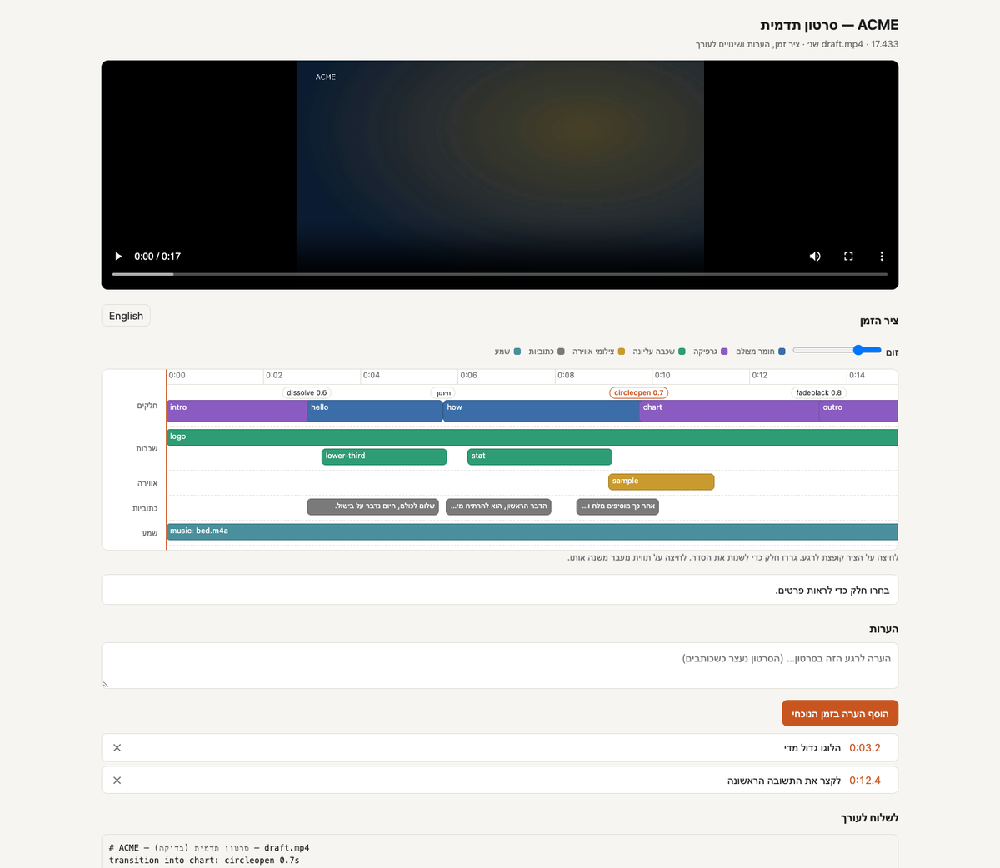

*[English](delivery.md) · עברית*

<div dir="rtl">

# מסירה

## גרסאות — אנכית, קצרה, לכל פלטפורמה

</div>

```json
"versions": {
  "reels": {"parts": ["intro", "ceo", "outro"], "output": {"width": 1080, "height": 1920}, "fit": "crop"},
  "30s":   {"parts": ["intro", "ceo", "chart", "outro"]},
  "silent-feed": {"captions": {"karaoke": true, "size": 34}, "music": {"volume": -16}}
}
```

```bash
python3 tools/vf.py render <name> --version reels      # -> renders/reels.mp4
```

<div dir="rtl">

`parts` בוחר את החלקים וקובע את הסדר שלהם. כל מפתח אחר דורס את הסיפור עבור הגרסה הזאת בלבד.
`fit: crop` ממלא פריים אנכי מתוך חומר מצולם ב-16:9, ו-`pad` מוסיף לו פסים (letterbox). הגרפיקה
בתנועה מרונדרת מחדש בגודל של הגרסה. שכבות עליונות וצילומי אווירה (b-roll) שקשורים לחלקים
שהגרסה משמיטה מדולגים.

## כתוביות בשפה שנייה

1. מרנדרים פעם אחת, כדי ש-`captions.srt` ומזהי הכתוביות (cue ids) יהיו קיימים.
2. Claude מתרגם אל `translations/en.json`:
   `{"cues": {"interview:0": "Hello everyone…", "interview:1": "…"}}`.
3. מוסיפים `"captions": {"translations": {"en": {"mode": "mux"}}}` ומרנדרים שוב.

`mux` מוסיף רצועת כתוביות שהצופה יכול להפעיל ולכבות, ו-`burn` צורב אותה לתוך התמונה (כברירת מחדל
ב-`top`, כדי שלא תסתיר את העברית). הרינדור מדווח על כתוביות שאין להן
תרגום.

## דף סקירה: ציר זמן והערות ללקוח



</div>

```bash
python3 tools/vf.py review <name>                 # renders/final_review.html
python3 tools/vf.py review <name> --draft         # the draft
python3 tools/vf.py review <name> --version reels --lang en
```

<div dir="rtl">

קובץ HTML סטטי אחד לצד הסרטון. הוא **לא צריך שרת**: פותחים אותו בלחיצה כפולה, או שולחים אותו יחד
עם הסרטון. המסלולים של העריכה מוטמעים בו מתוך `renders/<render>.timeline.json`, שכל רינדור כותב.

- **ציר זמן ויזואלי**: החלקים (חומר מצולם וגרפיקה בצבעים שונים), עם תווית בכל נקודת חיבור
  שמראה את המעבר שלה. מתחתם שכבות עליונות, צילומי אווירה, כתוביות ושמע, כל אחד במסלול משלו.
  סמן מיקום עוקב אחרי הסרטון, לחיצה בכל מקום קופצת לשם, ומחוון הזום מרחיב את הציר.
- **שינויים**: גוררים חלק כדי לשנות את הסדר. לוחצים על תווית מעבר כדי לבחור סוג ומשך אחרים
  (כל הסוגים שיש ב-FFmpeg שלכם). לוחצים על חלק כדי לראות את טווח המקור, האורך ולמה הוא שם.
- **הערות**: עוצרים על רגע, מקלידים ומוסיפים. לחיצה על הזמן של הערה קופצת חזרה אליו.
- **לשלוח לעורך**: הכול (סדר חדש, מעברים ששונו, הערות) הופך לטקסט אחד להעתקה או לשמירה:

</div>

```
# ACME — promo — final.mp4
order: intro, chart, hello, how, outro
transition into chart: circleopen 0.7s
0:03.2 — הלוגו גדול מדי
0:12.4 — לקצר את התשובה הראשונה
```

<div dir="rtl">

ההערות והשינויים נשמרים רק באותו דפדפן, כי דף לא יכול לכתוב לדיסק בלי שרת. מדביקים את הטקסט
ל-Claude, והוא מיישם אותו ב-`story.json` ומרנדר מחדש. בדף יש מתג עברית/אנגלית (`--lang` קובע
באיזו שפה הוא נפתח).

## סרטונים קצרים מסרטון ארוך

הופכים ראיון, הרצאה או פודקאסט לקליפים אנכיים:

1. ‏`python3 tools/vf.py candidates <name>` מדרג חלונות של 15–60 שנ׳ שיכולים לעמוד לבד (וו בהתחלה,
   מספרים, קצב, סיום שלם), וכותב את הטקסט המלא שלהם ל-`candidates.json`.
2. ‏Claude קורא ובוחר: קליפ צריך להיות מובן בלי הקשר, להיפתח במשפט החזק ביותר שלו ולהסתיים
   בשורה המחץ. הוא כותב את `clips.json` עם כותרת וו קצרה לכל קליפ.
3. ‏`python3 tools/vf.py clips <name>` מרנדר את כל הקליפים.

</div>

```json
{
  "style": {"width": 1080, "height": 1920, "fit": "crop", "karaoke_style": "word",
            "caption_size": 24, "hook_seconds": 2.5, "hook_place": "top",
            "end_card": {"vars": {"cta": "לכל הפרק", "line1": "youtube.com/@acme"}, "duration": 2.5},
            "music": {"file": "music/bed.mp3", "volume": -26}},
  "clips": [
    {"id": "c1", "source": "interview", "start": 312.4, "end": 351.0, "hook": "הטעות שכולם עושים", "why": "…"},
    {"id": "c2", "source": "interview", "start": 1204.0, "end": 1238.5, "hook": "3 דברים שלמדתי"}
  ],
  "cues": [{"id": "interview:41", "text": "corrected line"}]
}
```

<div dir="rtl">

כל קליפ מנוקה (הברות היסוס, ושתיקות שמתקצרות ל-0.4 שנ׳), נחתך ל-9:16 ומקבל כתוביות מילה-אחר-מילה.
בשניות הראשונות מופיעה כותרת הוו בשליש העליון, ונוספים הלוגו (מ-`brand.json`), עוצמה של ‎-14 LUFS,
ושקופית סיום אם הוגדרה. הפלט: `renders/clip_<id>.mp4`, כל אחד עובר בדיקת איכות. ‏`--only c2`
מרנדר מחדש קליפ אחד, ו-`--draft` לתצוגה מקדימה מהירה.

## צירי זמן לתוכנות עריכה

</div>

```bash
python3 tools/vf.py export <name> --format fcpxml   # Final Cut, DaVinci Resolve
python3 tools/vf.py export <name> --format edl      # Premiere, Resolve, Avid (CMX 3600)
python3 tools/vf.py export <name> --format otio     # OpenTimelineIO
```

<div dir="rtl">

ציר הזמן מצביע על הקבצים המקוריים (לא על עותקים), חתוכים כמו בסיפור. כרטיסי הגרפיקה
מרונדרים וממוקמים כקליפים. הכתוביות נכנסות בנפרד, כ-`captions.srt`. חלק שיש בתוכו חיתוכי
ניקוי הופך לכמה קליפים. במקרה כזה המעברים מיוצאים כחיתוכים ישרים, כדי שהמסה (dissolve) לעולם
לא תיפול באמצע משפט. שכבות עליונות, צילומי אווירה, מוזיקה ומראה לא נכללים בציר הזמן:
אלה שלבי גימור שעושים מחדש בתוכנת העריכה.

## בדיקות פלטפורמה וייצוא

</div>

```bash
python3 tools/vf.py ff check renders/final.mp4 --platform youtube    # or reels, tiktok, shorts, linkedin, x …
python3 tools/vf.py ff export renders/final.mp4 --preset youtube --max-mb 25
python3 tools/vf.py ff export renders/final.mp4 --preset gif
python3 tools/vf.py ff metadata renders/final.mp4 --chapters chapters.txt
```

<div dir="rtl">

`check` מוודא גודל, אורך, קצב פריימים, codec ועוצמה מול הדרישות של
הפלטפורמה. למסירה לרשת, הגדירו `"loudness": -14` בסיפור. ההגדרה חלה רק על רינדורים
סופיים.

</div>
