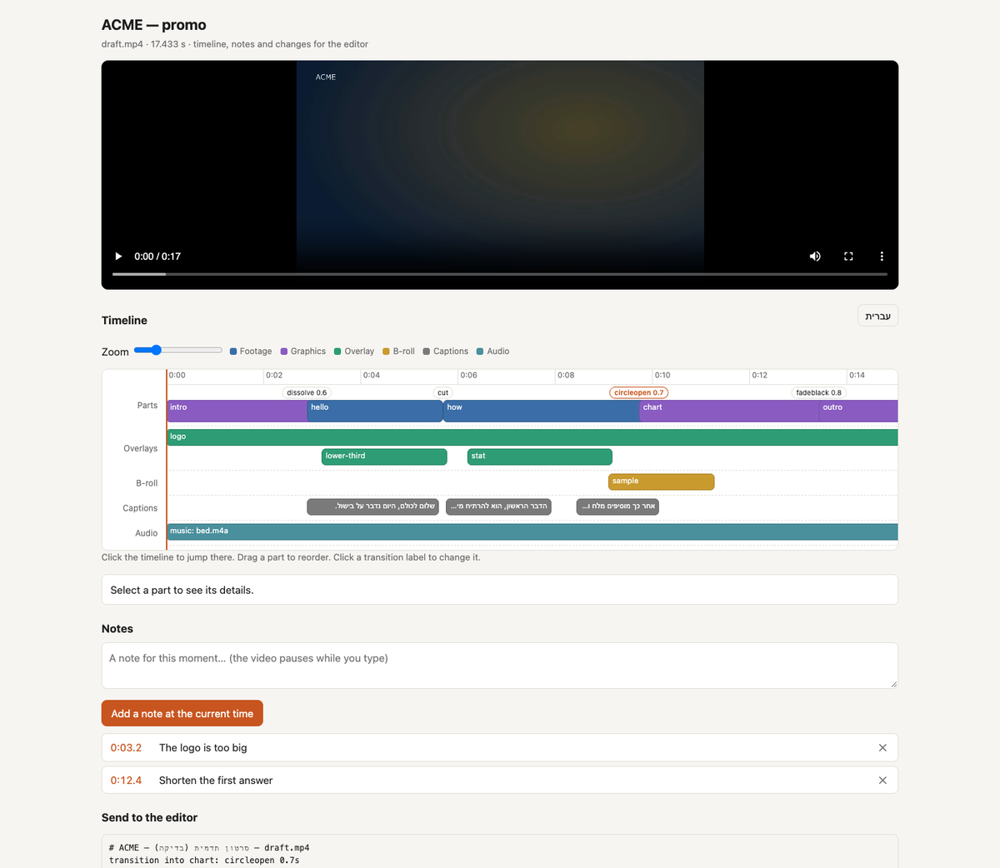

*English · [עברית](delivery.he.md)*

# Delivery

## Versions — vertical, short, per platform

```json
"versions": {
  "reels": {"parts": ["intro", "ceo", "outro"], "output": {"width": 1080, "height": 1920}, "fit": "crop"},
  "30s":   {"parts": ["intro", "ceo", "chart", "outro"]},
  "silent-feed": {"captions": {"karaoke": true, "size": 34}, "music": {"volume": -16}}
}
```

```bash
python3 tools/vf.py render <name> --version reels      # -> renders/reels.mp4
```

`parts` picks and orders the parts. Any other key overrides the story for that version only.
`fit: crop` fills a vertical frame from 16:9 footage, and `pad` letterboxes it. Motion graphics
re-render at the version's size. Overlays and b-roll tied to parts the version drops are
skipped.

## Second-language subtitles

1. Render once, so that `captions.srt` and the cue ids exist.
2. Claude translates into `translations/en.json`:
   `{"cues": {"interview:0": "Hello everyone…", "interview:1": "…"}}`.
3. Add `"captions": {"translations": {"en": {"mode": "mux"}}}` and render again.

`mux` adds a subtitle track the viewer can toggle, and `burn` burns it into the picture (at the
`top` by default, so it does not cover the Hebrew). The render reports cues that have no
translation.

## Review page: timeline and client notes



```bash
python3 tools/vf.py review <name>                 # renders/final_review.html
python3 tools/vf.py review <name> --draft         # the draft
python3 tools/vf.py review <name> --version reels --lang en
```

One static HTML file next to the video. It needs **no server**: open it by double-click, or send it
with the video. The edit's tracks are embedded in it from `renders/<render>.timeline.json`, which
every render writes.

- **Visual timeline**: parts (footage and graphics in different colours) with a label at each
  junction showing its transition, then overlays, b-roll, captions and audio, each in its own
  lane. A playhead follows the video, a click anywhere jumps there, and the zoom slider widens it.
- **Changes**: drag a part to reorder it; click a transition label to pick another type and length
  (every type your FFmpeg has); click a part to see its source range, length and why it is there.
- **Notes**: pause on a moment, type, add. A click on a note's time jumps back to it.
- **Send to the editor**: everything (new order, changed transitions, notes) becomes one text, to
  copy or save:

```
# ACME — promo — final.mp4
order: intro, chart, hello, how, outro
transition into chart: circleopen 0.7s
0:03.2 — הלוגו גדול מדי
0:12.4 — לקצר את התשובה הראשונה
```

Notes and changes are kept in that browser only; a page cannot write back to your disk without a
server. Paste the text to Claude, who applies it to `story.json` and renders again. The page has an
English / Hebrew toggle (`--lang` sets where it starts).

## Shorts from a long video

Turn an interview, a lecture or a podcast into vertical clips:

1. `python3 tools/vf.py candidates <name>` ranks windows of 15–60 s that could stand alone (a hook up
   front, numbers, pace, a complete ending) and writes their full text to `candidates.json`.
2. Claude reads them and picks: a clip must make sense with no context, open on its strongest line,
   and end on a payoff. It writes `clips.json` with a short hook title for each.
3. `python3 tools/vf.py clips <name>` renders every clip.

```json
{
  "style": {"width": 1080, "height": 1920, "fit": "crop", "karaoke_style": "word",
            "caption_size": 24, "hook_seconds": 2.5, "hook_place": "top",
            "end_card": {"vars": {"cta": "לכל הפרק", "line1": "youtube.com/@acme"}, "duration": 2.5},
            "music": {"file": "music/bed.mp3", "volume": -26}},
  "clips": [
    {"id": "c1", "source": "interview", "start": 312.4, "end": 351.0, "hook": "הטעות שכולם עושים", "why": "…"},
    {"id": "c2", "source": "interview", "start": 1204.0, "end": 1238.5, "hook": "3 דברים שלמדתי"}
  ],
  "cues": [{"id": "interview:41", "text": "corrected line"}]
}
```

Each clip is cleaned (fillers, pauses down to 0.4 s), cropped to 9:16, captioned word by word,
gets the hook title in the top third for its first seconds, the logo (from `brand.json`), loudness
−14 LUFS, and the end card if given. Output: `renders/clip_<id>.mp4`, each checked by QA.
`--only c2` re-renders one; `--draft` for quick previews.

## Editor timelines

```bash
python3 tools/vf.py export <name> --format fcpxml   # Final Cut, DaVinci Resolve
python3 tools/vf.py export <name> --format edl      # Premiere, Resolve, Avid (CMX 3600)
python3 tools/vf.py export <name> --format otio     # OpenTimelineIO
```

The timeline points at the original files (not copies), cut as in the story. Motion cards are
rendered and placed as clips. Captions go in separately as `captions.srt`. A part with cleaned-up
cuts inside becomes several clips. In that case transitions are exported as straight cuts, so a
dissolve never lands inside a sentence. Overlays, b-roll, music and look are not in the timeline:
they are finishing steps you redo in the editor.

## Platform checks and exports

```bash
python3 tools/vf.py ff check renders/final.mp4 --platform youtube    # or reels, tiktok, shorts, linkedin, x …
python3 tools/vf.py ff export renders/final.mp4 --preset youtube --max-mb 25
python3 tools/vf.py ff export renders/final.mp4 --preset gif
python3 tools/vf.py ff metadata renders/final.mp4 --chapters chapters.txt
```

`check` verifies size, length, frame rate, codec and loudness against the platform's
requirements. Set `"loudness": -14` in the story for web delivery. It is applied on final
renders only.
